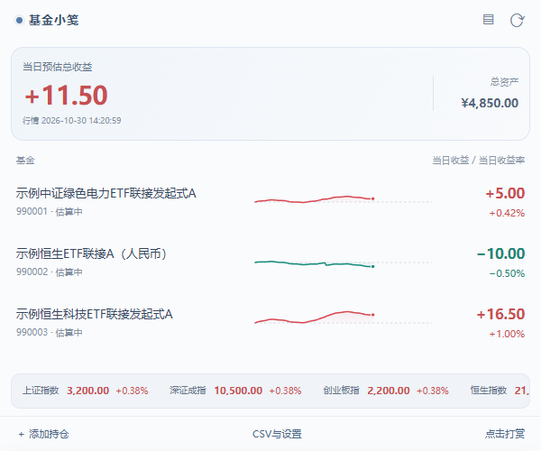
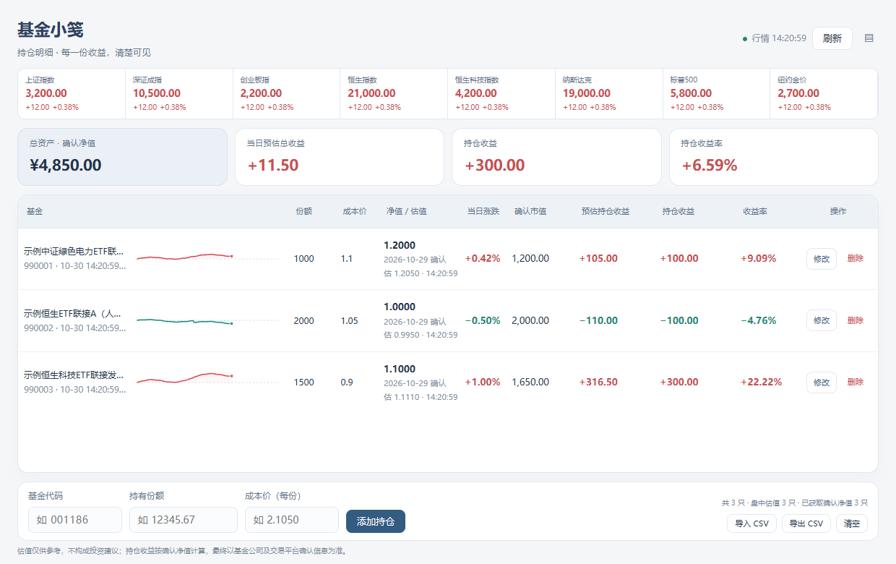

# 基金小笺 · Fund Note

[English](README.en.md) · [下载1.1.2](https://github.com/power32m/fund-note/releases/tag/edge-v1.1.2) · [图文教程](docs/CHROME.zh-CN.md) · [隐私政策](PRIVACY.md)

**用一张小笺查看基金持仓、行情日收益与日内估值走势。**

当前版本：**Edge 1.1.2**，中文界面、中英文商店资料。已在Edge 156独立测试环境验证；此前已提交Edge商店审核，当前商店审核及上线状态以后台为准，本仓库下载包不代表已通过商店审核。未上架Chrome Web Store。

持仓保存在浏览器本地，无需软件账号。本仓库仅发布文档、模拟截图和安装包，不公开应用源码，不提供开源许可；安装包中的扩展资源可以被检查。

## 界面预览

以下截图使用虚构基金和模拟行情，不代表真实持仓或投资表现。

## 主要功能

- Popup显示行情日收益、单只基金涨跌幅与总资产；完整视图管理份额和成本。
- 原图标叠加整数收益角标：盈利红底、亏损绿底、白色数字；悬停查看完整金额与日期。
- 日内走势每分钟最多保留一个有效来源点。同日持仓共用零线居中的比例，从±1%起扩大，当天不缩小，重启保留。不同日期分别计算。
- 午休11:30—13:00压缩连接。相邻点有效交易时间差不超过10分钟用实线连接，更长留空；缺口悬停提示数据缺失，不推算中间涨幅、不补造历史点。
- 指数默认单行滚动，停留1秒展开双列面板，移开渐隐。
- CSV导入前预览、确认后替换，最多10份本地修改前备份。
- 按市场时段刷新，后台复用一分钟定时器并容忍5秒触发误差；手动冷却和休市频率保持。
- 自愿打赏入口展示作者微信收款码，不影响功能，不自动付款、不读取支付结果。

## 下载与更新

1. 从[Release](https://github.com/power32m/fund-note/releases/tag/edge-v1.1.2)下载 基金小笺-Edge-1.1.2.zip 和 SHA256SUMS.txt。
2. 核对SHA256后解压，在Edge扩展管理页 edge://extensions 开启开发者模式，选择“加载解压缩的扩展”，选中直接包含manifest.json的目录。
3. 在工具栏打开基金小笺，添加自己的6位场外基金代码、份额和每份成本。首次安装为空持仓。

更新前导出CSV。相同解压目录的已有安装可覆盖运行文件后点击“重新加载”，不要先卸载；若更换扩展ID、浏览器或配置文件，先导出后导入，不保证自动迁移。GitHub自动生成的Source code压缩包只有本仓库文档，不能安装。此前1.0包保留为历史版本。

## 数据与使用边界

估值不等于确认收益，行情可能延迟或中断；最终以基金公司与交易平台确认为准。当天缺少行情时标注最近行情日，不混合不同日期汇总。成本、分红、费用等会影响与平台的对比；本工具没有完整交易、分红和手续费账本，不执行交易或提供投资建议。

走势从启用后实际接收的数据开始，不补历史；最多保留5个已采集行情日，另有容量上限。浏览器退出、休眠、断网及数据源停更可能造成缺口；连接线不代表中间已获得行情。页面交易时段通常15秒尝试更新、后台通常每分钟检查；请求频率不代表数据源更新频率，不保证实时、持续可用或长期维护。

持仓、成本、走势及备份存于本机，不使用云同步、广告追踪或遥测。行情请求向两家服务发送代码和必要参数，不发送份额或成本；服务商可能收到IP等连接信息。卸载会删除本地数据，CSV需自行保管。

[隐私政策](PRIVACY.md) · [免责声明](DISCLAIMER.md) · [下载安全](SECURITY.md) · [许可](LICENSE) · [第三方说明](THIRD_PARTY_NOTICES.md) · [更新记录](CHANGELOG.md)

反馈：[Issues](https://github.com/power32m/fund-note/issues)，请隐藏真实持仓、账号及支付信息。作者：无痛穿耳 / power32m。
