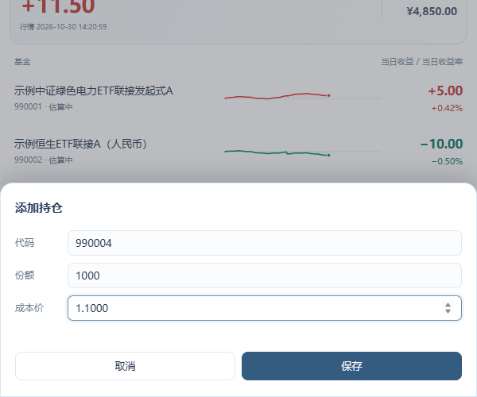
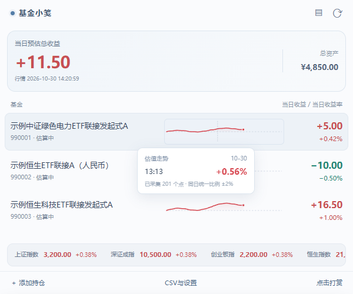
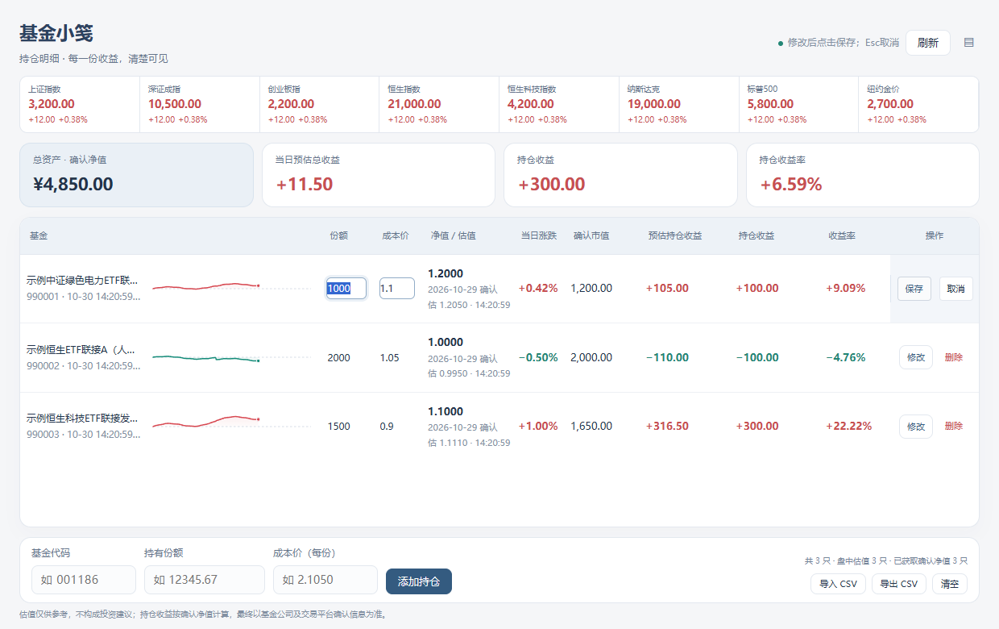
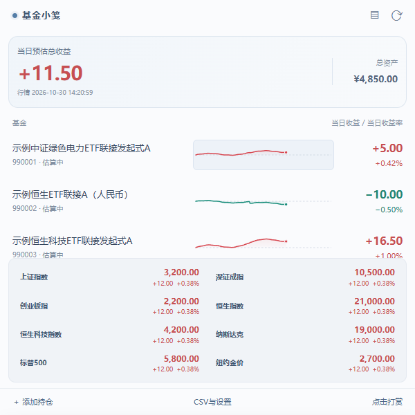
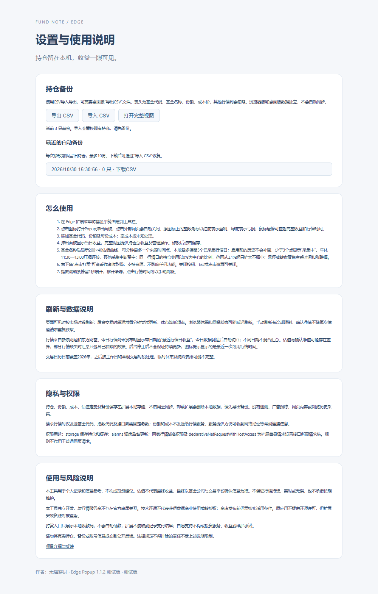

# Fund Note — User guide

Version: Edge 1.1.2. Screenshots use demo data. Store publication status is not implied. The UI is Chinese.

## Install and open

After publication, use the official Microsoft Edge Add-ons listing to select Get and confirm installation. Show Fund Note in the browser toolbar, then click its icon. There is no store installation link yet. The first launch contains no holdings and requires no application account. Clicking outside the popup closes it; the full-view button opens a separate tab.

## Add holdings

Select 添加持仓 (Add holding). Enter a six-digit off-exchange fund code, the number of units held, and cost per unit. Units are not the investment amount, and cost is not the total purchase amount. ETF feeder funds are supported when quote data is available; this is not an exchange-traded stock trading tool. Blank or zero cost is treated as unknown. The 990001-series screenshot codes are fictional and should not be entered as real funds.

## Understand returns

The popup emphasizes the displayed quote day's indicative return and each fund's daily return and percentage. Total assets are shown separately. When today's data is unavailable, the latest valid quote day is explicitly identified. Returns from different dates are not combined; a partial total includes only eligible funds. Indicative values may differ from confirmed NAV and platform settlement.

The toolbar badge uses white digits on red for gains, green for losses and gray for zero. It shows the rounded absolute amount without a sign or decimals. Hover over the icon for the signed amount, quote date and update time. In full view, holding return is measured against the entered cost and differs from daily return. There is no comprehensive transaction, dividend or fee ledger.

## Read the intraday preview

The 200×40 chart beside each fund reuses existing estimate responses. It retains at most one point per minute; a newer source timestamp can replace that minute's point. A fresh point is not guaranteed every minute. Fewer than three points displays 采集中 (Collecting).

Collection starts after enabling the feature; earlier history is not backfilled. Browser shutdown, sleep, network failure or unavailable estimates can leave gaps. The 11:30–13:00 lunch break is compressed and connected; effective gaps over five and up to ten minutes use solid connectors, while longer gaps stay blank. Hovering over a gap shows the missing interval without an inferred return. Future portions of the daily axis remain empty. Holdings for the same quote day share a zero-centered scale, starting at ±1% and expanding in whole percentage points without shrinking that day. Different dates use separate scales. Hover for time and percentage.

Up to five collected quote days are retained, with cleanup on loading or writing and an additional storage cap. These are collected days, not five calendar days. Deleting a holding removes its chart history. CSV exports do not contain chart history.

## Edit and manage

Open full view for units, cost, NAV, estimates and holding returns. Select 修改 (Modify) before editing units or cost, then 保存 (Save) or 取消 (Cancel). Row actions can also be revealed by swiping left. If another page has already changed the holdings, refresh before editing to avoid overwriting newer data. Check the fund name before deletion and export a backup before important changes.

## Indices and refresh

The bottom ticker expands into a two-column index panel after one second of hovering and fades when the pointer leaves. Red indicates a rise and green a fall. A brief update flash reflects the change since the previous fetch.

Use the refresh button or the quote-time area to request an update. Caching, request merging and cooldowns prevent repeated clicks from generating unlimited requests. Automatic refresh adapts to market sessions and page state; polling does not guarantee real-time source data.

## CSV and recovery

Open CSV与设置 (CSV and settings) to export holdings. Keep the file private: it includes fund codes, names, units and costs. Import validates the file and displays a preview; confirmation replaces the current holdings rather than appending them. Export the existing holdings first and preserve leading zeros in codes.

Up to ten local pre-edit snapshots can be downloaded as CSV and imported for recovery. An empty snapshot contains no holdings to recover. No cloud sync is used. Uninstalling, clearing extension data or changing browser profiles can remove access to data. Export before moving from an unpacked build to a store build: their extension IDs may differ, so automatic migration should not be assumed.

## Optional support and privacy

点击打赏 (Support) displays the author's WeChat payment QR code. Support is voluntary and does not unlock features. The extension neither initiates a payment nor reads payment results. Close with the close button, Escape or the backdrop; check recipient details in the payment platform yourself.

Holdings, costs, backups and charts stay in local extension storage. Quote requests send necessary fund/index codes and fixed parameters to third-party providers, not entered units or costs. Providers may receive IP addresses and connection metadata. Refer to the release privacy policy.

## Troubleshooting

A dash indicates unavailable data, not a zero return. Check the code, network, date and estimate availability. Collecting requires three valid points and does not backfill history. An unchanged value may reflect a cooldown, a closed market or an unchanged source quote.

After an extension update, an unsupported-operation error may indicate an old background worker with a newer page. Export a backup, restart/reload the extension in the browser's extension manager, and reopen the popup. The in-app quote refresh does not reload the extension itself.

For return differences, verify units, per-unit cost, NAV date, dividends and fees against your platform. Confirmed fund-company and platform records prevail. Feedback: https://github.com/power32m/fund-note/issues . Do not post holdings, CSV files, account or payment details. This is a personal information tool, not investment advice; availability, real-time accuracy and returns are not guaranteed.
