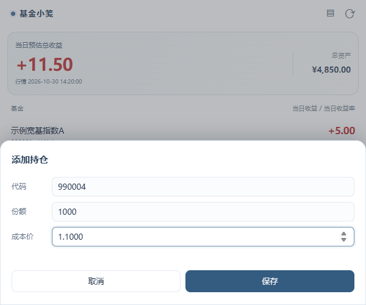
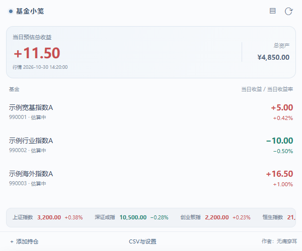
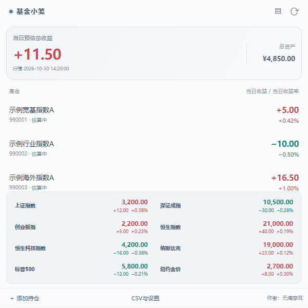
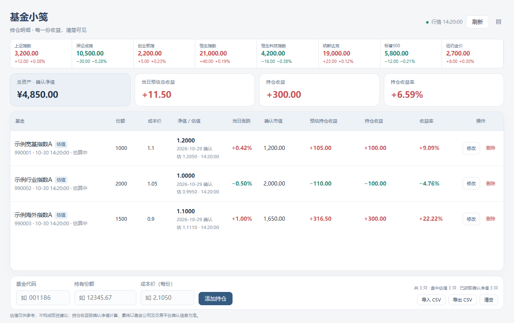
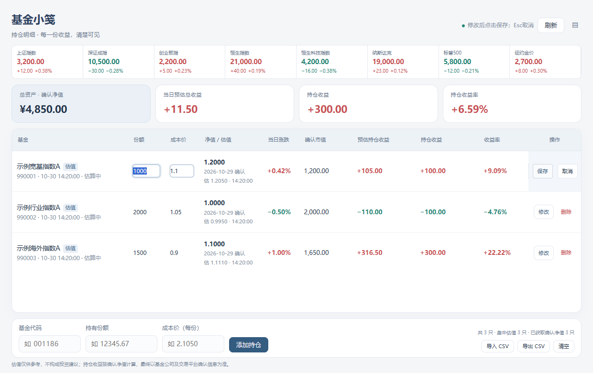
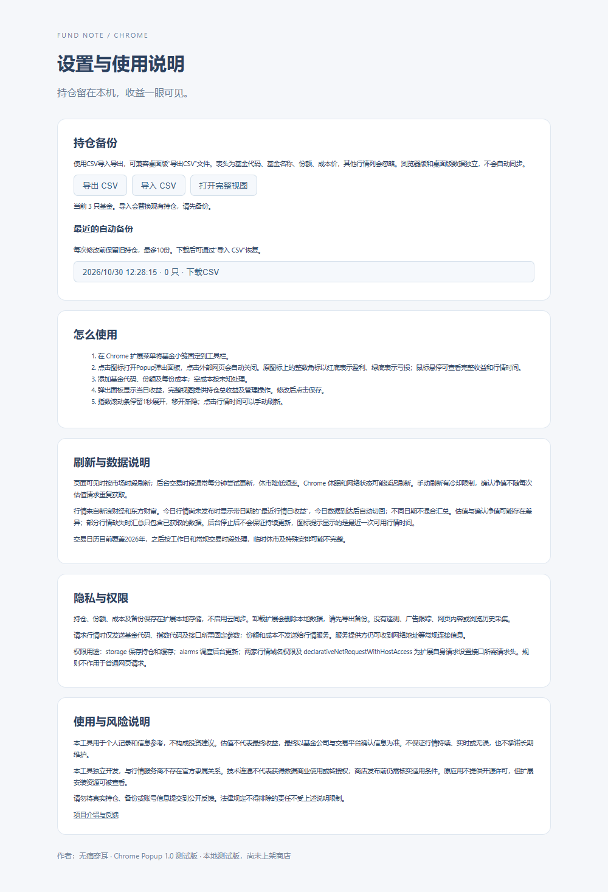

# Chrome 版图文使用指南

[返回项目介绍](../README.md) · [English](CHROME.en.md)

版本：Chrome 1.0 测试版（1.0.0）。截图使用虚构代码990001等与模拟金额，请勿将这些代码用于实际持仓录入。

## 1. 安装并固定图标

从 [Release](https://github.com/power32m/fund-note/releases/tag/chrome-v1.0.0-test) 下载 `FundNote-Chrome-1.0.0-test.zip`，核对校验值后解压。打开 `chrome://extensions` → 开发者模式 → 加载已解压的扩展程序 → 选择 `chrome-extension` 文件夹。不要选ZIP文件或外层目录。

在Chrome拼图菜单固定“基金小笺”。首次打开为空持仓，点击底部“添加持仓”。要求Chrome 127或更新版本；安装目录应长期保留，移动后需重新选择目录。

## 2. 添加自己的持仓

输入6位基金代码、持有份额、每份成本价，然后保存。成本未知可留空，软件不据此计算持仓总收益；仍可依据份额显示有可用行情的该日收益。基金可能没有盘中估值，缺失数据以页面提示为准。

## 3. 查看小笺与收益角标

Popup顶部大字为行情日收益，右侧为按确认净值计算的总资产；列表展示每只基金的该日收益和收益率。点击网页其他位置会关闭Popup，再次点击图标可打开。

工具栏保留原蓝色图标，并叠加整数角标：红底白字代表盈利，绿底白字代表亏损；金额取绝对值后四舍五入，不显示正负号与小数。鼠标悬停查看完整带符号金额、行情日期和时间。没有可用收益时不显示数字，部分行情以面板及悬停提示为准。

今日行情尚未发布时会显示“最近行情日收益”及日期，避免把旧行情误认为今日数据。不同日期不会混合汇总。

## 4. 展开指数与手动刷新

底部行情默认滚动。鼠标停留满1秒展开双列指数面板，移开后渐隐收起。红涨绿跌；刷新时的颜色提示表示与上次取得价格的变化。

点击右上角刷新图标，或点击行情时间手动更新；两个入口共用10秒冷却。确认净值另有缓存与请求间隔，连续点击不一定产生新数据。

## 5. 完整视图中修改或删除

点击右上角列表按钮，在新标签页打开完整视图。点击基金行的“修改”，编辑份额、每份成本后点击“保存”；选择“取消”或按Esc可放弃。Enter可保存。桌面鼠标可向左拖动基金行显示操作，亦可使用右侧按钮。删除或清空前会确认。

同时打开多个页面时，旧页面不能覆盖新页面已经保存的持仓。出现冲突提示，请重新打开页面，核对后再编辑。

## 6. CSV 导入、导出与恢复

从Popup底部“CSV与设置”进入设置页面。完整视图底部也可导入和导出CSV。

- **导出**：保存当前持仓的CSV。表头为基金代码、基金名称、份额、成本价。
- **导入**：选择CSV，校验后预览并确认。导入会替换当前持仓，错误文件不会覆盖。
- **恢复**：从“最近的自动备份”下载所需CSV，再导入该文件。每次修改前最多保留最近10份。

支持UTF-8、UTF-16LE和常见GB编码，导出采用带BOM的UTF-8；保留基金代码前导零，兼容桌面版CSV的额外行情列。注意：CSV含真实持仓，不要放入公开Issue或分享包。

## 7. 更新、卸载和迁移

更新现有测试版：先导出CSV备份，关闭扩展页面，将新版运行文件覆盖到原安装目录，在 `chrome://extensions` 点击“重新加载”。同目录更新可保留持仓，不要先卸载。未来商店版ID可能不同，届时通过CSV迁移。

卸载扩展会清除其本地数据和自动备份。浏览器版与桌面版数据不自动同步，需用CSV转移。请先阅读[隐私说明](../PRIVACY.md)和[安全说明](../SECURITY.md)。
